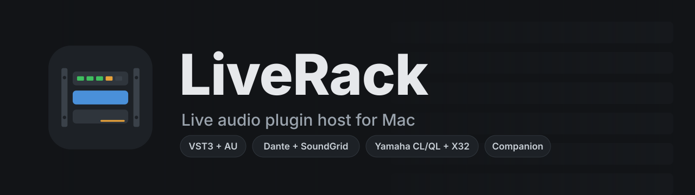
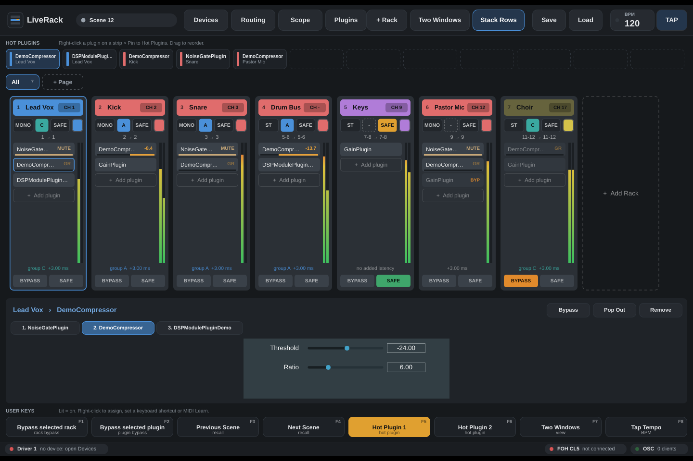

<p align="center"></p>

**LiveRack** hosts racks of VST3 and Audio Unit plugins for live mixing, in the spirit of Waves SuperRack and Fourier transform.engine. It runs on a Mac with Apple silicon, talks to your console over Dante or the Waves SoundGrid Driver, follows scene recalls and channel selection from Yamaha CL/QL and Behringer X32 consoles, and can be driven from a Stream Deck through Bitfocus Companion.

<p align="center"></p>

### Highlights
- **Racks:** mono, stereo or mono-to-stereo racks, each with its own plugin chain, meters, gain reduction and bypass
- **Several audio drivers at once** (Dante Virtual Soundcard, SoundGrid, any CoreAudio device), each on its own audio thread
- **Console-style routing matrix** with automatic output patching
- **Latency groups A–H** keep related inputs sample-aligned
- **Console Link:** follows scene recalls and channel selection (Yamaha RCP, X32 scenes/snippets/cues)
- **Snapshots with scope** down to individual plugins, Recall Safe racks, in-place recall with no audio gap
- **Custom pages, Hot Plugins, User Keys,** keyboard shortcuts, MIDI controllers with MIDI Learn, tap tempo
- **iPad / web remote:** run racks and every plugin parameter from Safari on an iPad, including **the plugin's own window, live** (Mac)
- **OSC remote** and a **Companion module** (`companion-module-liverack-host/`)
- **Mac and Windows** builds (Windows with ASIO for Dante Virtual Soundcard and SoundGrid)

> Status: early and in active development. Test it on your rig before relying on it for a show.

---

## Download

Get the latest build from [Releases](../../releases): the Mac app (Apple silicon), the Windows app (x64, ASIO) and the Companion module. Every push to `main` is also built under [Actions](../../actions).

- **Mac:** unzip, then right-click `LiveRack.app` > **Open** the first time (it isn't notarised).
- **Windows:** unzip and run `LiveRack.exe`. If Windows warns about an unknown publisher: **More info > Run anyway**. Pick your ASIO driver (Dante Virtual Soundcard, SoundGrid) in Devices > driver Settings.

# User guide (v0.13)

Any number of independent racks of VST3/AU plugins on one or more audio drivers at once (Dante Virtual Soundcard, a Dante interface, the Waves SoundGrid Driver). Everything lives in one **show file** (`.liverack`) with its snapshots inside it, and the open show comes back automatically on launch.

## Build (Mac, Apple silicon)

Double-click `build.command` (installs CMake with Homebrew if needed, builds, and writes `build.log`). Or by hand:

```
cmake -B build -G Xcode
cmake --build build --config Release
```

App: `build/LiveRack_artefacts/Release/LiveRack.app`

## The main window

- **Top bar,** in groups: **Show** (save; open, save as, new), **Snapshots** (previous / next, the current snapshot: click it for the list, rename and delete; **STORE**), **Setup** (Devices, Routing, Plugins, Scope), **View** (add rack, rack window, stack rows), and **BPM** with **TAP**. Hover a button for its name. Click the BPM number to type a tempo.
- **Pages** (tabs above the strips): **All** shows every rack; **+ Page** makes a page (starting with the selected rack). Put racks on pages from a rack's right-click menu > **Pages** (a rack can be on several), or right-click a page tab > Add. New racks join the page you're on. Selecting a rack (from the console, a key, MIDI or OSC) switches to a page that has it. Pages are saved in the show, not in snapshots.
- **Hot Plugins** (under the top bar): up to 12 pinned plugins. Right-click a plugin on a strip > **Pin to Hot Plugins**. Click a tile to open that plugin; drag tiles to reorder; right-click to unpin. Hot Plugins are saved in the show.
- **Strips:** each rack's header shows its name and console channel (**CH**, click to set). Double-click the name to rename in place. The badges under it are buttons:
  - **MONO / M>S / ST**: switch format: mono, mono in with stereo out, or stereo (the rack drops out for a moment while its plugins switch over)
  - **A–H**: latency group (dashed = none)
  - **SAFE**: Recall Safe
  - colour swatch: pick a colour
  - The line under the badges (e.g. `1 → 1`) shows routing; click it to open **Routing** for that rack.
- **User Keys** (bottom): 8 assignable buttons, lit when what they control is on. Right-click to **Assign** (bypass a rack or plugin, select a rack, open a plugin, Hot Plugin 1–12, recall / next / previous / store scene, show a page, tap tempo, two windows), **Set keyboard shortcut** or **MIDI Learn**.
- **Keyboard shortcuts:** F1–F8 press the User Keys and T taps tempo by default. Change any of them, or add shortcuts for other actions, in Devices > Controllers > **Keyboard shortcuts**. LiveRack warns when keys are already used and refuses ones macOS needs (Cmd+Q, Cmd+W...). Shortcuts work while a LiveRack window is in front.
- **Status bar:** one chip per audio driver (rate, buffer, DSP with 10 s peak, dropouts with the time of the last one), then consoles and the OSC remote. Click it to open Devices.

## Devices

- **Audio drivers:** each driver is a panel with a status light, rate, buffer, channels, dropouts, DSP and the racks on it. **Settings** picks the device; **+ Add driver** adds another (up to 4). Each driver runs on its own audio thread, so a hiccup on one doesn't touch the other.
  - A rack runs entirely on one driver: its inputs and outputs are on the same driver. Patching a rack to another driver's channel in Routing moves it there.
  - Two drivers aren't clock-locked to each other inside the Mac. That's fine as long as each rack stays on one driver.
- **Consoles:** one panel per console (+ Add console for more). Each shows its card slots: click a slot to say what's in it (Dante, Waves SoundGrid, stage box...) and which driver channels it arrives on. Routing uses this to label its channel blocks, e.g. "MY Slot 1". Live tiles show the last scene, the selected channel and its rack, and when the console last sent anything. **Settings** opens the connection settings (console type, IP, scene folder, X32 follow and Learn, and the log).
- **Controllers:** starts with no MIDI devices: **+ Add MIDI device** lists what's plugged in. Only added devices are used; an unplugged one stays listed as "not connected" and reconnects on its own. Right-click a device to remove it (with or without its mappings). Also here: MIDI mappings, Keyboard shortcuts and the OSC remote. Lights flash as messages arrive.

## Routing

A console-style crosspoint matrix. Rack inputs (or outputs) run down the side, driver channels across the top, 32 per page. Click a crosspoint to patch, click a lit one to unpatch. Stereo racks patch L and R separately; mono-to-stereo racks have one input and L/R outputs.

**Auto-patch:** patching an input also patches the rack's output to the same number, if that output isn't patched yet and no other rack uses it (otherwise Routing says so and leaves it). Mono-to-stereo racks take the next output too for R. A red ring means two racks share an output (they add together). Switch between **Rack inputs / Rack outputs**, drivers, and channel pages with the tabs. Channel numbers count the channels *enabled* in that driver's Settings.

## Mono-to-stereo racks

Set a rack's format badge to **M>S**: one input, stereo outputs. Plugins run mono until the **stereo point**, then stereo. For example: gate (mono), compressor (mono), reverb (mono in, stereo out), stereo EQ.

- In the picker, a reverb, delay or modulation effect added while the rack is still mono becomes the stereo point; other effects load their mono version. After the stereo point, stereo versions load.
- Plugins with fixed versions (Waves Mono, Mono/Stereo, Stereo) are swapped automatically when you drag them across the stereo point, keeping their settings.
- Right-click any plugin > **Make this the stereo point** to choose it yourself. The stereo point has a blue mark on the strip.
- With no stereo point, the mono signal goes to both outputs.

## Latency groups

Give racks a group letter (A–H) with the badge on the strip. Every rack in a group is delayed to match the slowest one, so all those inputs stay sample-aligned. It re-aligns automatically when plugins are added, removed or change their latency. A bypassed rack in a group keeps the group's delay. Ungrouped racks stay as fast as possible. The strip shows the group and the rack's total latency; the group menu shows each group's latency. Channels that don't go through LiveRack aren't delayed: if they need to line up, set the console's input delay to the group's figure.

## Show file and snapshots

- The **show** holds everything: racks, plugins and their settings, routing, latency groups, pages, Hot Plugins, User Keys, BPM, scope, the rack window, and all the snapshots. **Save** (Cmd+S) writes it; the folder button has **Save As**, **Open** (Cmd+O) and **New Show**. The window title shows the show's name and "(edited)" when it has unsaved changes; opening another show asks first. An edited show is also kept automatically every minute and on quit, and comes back on launch.
- A **snapshot** is a numbered (and optionally named) set of plugin settings stored in the show. **STORE** stores one; console scene numbers map to snapshot numbers.
- Recalling a snapshot **never adds, removes or moves plugins or racks**. It sets the settings and bypass of the plugins already in the show, and (if in scope) rack bypass and BPM. A plugin added after the snapshot was stored is left as it is (the status bar says how many); a plugin that was deleted is skipped.
- **Scope:** each snapshot has its own: what its recall changes (plugin settings, plugin bypass, rack bypass, BPM) and which plugins it touches. The Scope window edits any snapshot's scope (pick it at the top right), or the "New snapshots" scope that a newly stored snapshot starts with. Click a plugin, or a rack's name for the whole rack, to include it or leave it alone. Also from the snapshot list (**Scope of Snapshot**) and a plugin's right-click menu (**Recalled by new snapshots / by snapshot N**). With plugin bypass out of scope, a recall keeps the plugin's current bypass even if its saved settings include a bypass switch.
- **Recall Safe** racks are never touched by recalls.
- Old files: opening a pre-0.13 `.liverack` file opens it as a show. Scene files in a console's scene folder are imported into the show the first time their scene is recalled (if they have the same racks and plugins).

## Rack window

The plugin panel shows the selected rack: its colour, name, console channel, latency, in/out meters, **Rack Bypass**, and a tab for each plugin. A resizable plugin window is sized to fit the panel. One that can't resize and doesn't fit isn't squeezed in: **Pop Out** opens it in its own window, or make the window bigger and it comes back. The rack window button (View group) moves it into its own window, e.g. on a second screen. Whether it's open and where are saved in the show.

## Console Link (follow the console, like Waves ProLink)

- **Yamaha CL/QL:** Remote Control Protocol, TCP port 49280. Use the console's IP from SETUP > NETWORK (FOR MIXER CONTROL).
- **Behringer X32:** OSC on UDP port 10023. Choose whether LiveRack follows **Scenes, Snippets or Cues**, press **Learn**, then recall one on the X32.

Workflow: set up racks, then **STORE** a snapshot with the console's scene number. When the console recalls scene 12, LiveRack recalls snapshot 12. Give racks a console channel (**CH** on the strip) so selecting that channel on the console selects the rack.

## MIDI controllers

Any number of MIDI devices at once. **MIDI Learn:**
- for a User Key: right-click it > MIDI Learn, then press a button on your controller
- for a plugin parameter: right-click the plugin > Parameters, select a parameter, **MIDI Learn**, then choose **This plugin only** or **Follow the selected rack** (one set of knobs for every rack: it controls the plugin in the same position in whichever rack is selected)

Buttons (notes, CCs above 0, program changes) press; CCs move parameters. LiveRack sends LED feedback (note or CC 127 / 0) to the MIDI output with the same name as the input. Mappings are listed under Devices > MIDI mappings.

## iPad / web remote

LiveRack runs a small web server (port 8080; Devices > Controllers > **iPad / web remote** shows the address and turns it on or off). On an iPad on the same network, open that address in Safari, e.g. `http://192.168.1.20:8080`. **Share > Add to Home Screen** gives it an app-like icon that opens full screen.

- Rack strips for the current page: tap the header to select, **BYPASS** to bypass, with level and gain reduction
- Tap a plugin to open **all its parameters** as touch sliders (with filter and plugin bypass); meters like gain reduction show read-only
- Pages, User Keys, previous / next scene and tap tempo
- Any number of iPads, phones or computers at once; it shows "Not connected" if LiveRack goes away

### Plugin windows on the iPad (Mac)

Tapping a plugin shows **its own window, live**, and you work it with your fingers. LiveRack opens the window on the Mac if it isn't open, keeps it in front while the iPad uses it, and closes it again when you're done.

- **Tap** = click, **drag** = click-drag (knobs, faders, EQ points), **double-tap** = double-click (resets many controls)
- **Two-finger drag** = scroll wheel, **two-finger tap** = right-click
- **Shift / Option / Cmd / Ctrl** stay on until tapped again: Shift-drag for fine adjust, Option-click to reset, as each plugin does it
- **Right-click** makes the next tap a right-click; **Keyboard** types into the plugin's value boxes
- The plugin's preset and option menus open as a touch list
- **Sharp / Fast** picks picture quality; **Sliders** goes back to the parameter list
- **First time:** macOS asks for **Screen Recording** permission for LiveRack (System Settings > Privacy & Security > Screen & System Audio Recording). Turn it on and reopen LiveRack. Because builds aren't signed with an Apple developer ID, each new LiveRack version needs the switch turned off and on again.

On Windows the iPad shows the sliders for now.

## Companion

The `companion-module-liverack-host` folder holds a module for Bitfocus Companion 5 (module API 2.1): actions, feedbacks, variables and ready-made presets (rack bypass buttons in each rack's colour with gain reduction, User Keys, Hot Plugins, scenes, tap tempo, pages). Double-click its `install.command` to build it, then import the `.tgz` in Companion (Modules > Import module package). See its README.

## OSC remote (for Companion)

On by default on UDP port **9010** (change it in Devices). Whoever sends a message gets feedback sent back to the address and port it came from; send `/liverack/ping` (or anything) at least once a minute to keep it coming. Numbers are 1-based.

Commands:
- `/liverack/rack/<n>/bypass [0|1]` (no argument = toggle), `/liverack/rack/<n>/select`
- `/liverack/rack/<n>/slot/<m>/bypass [0|1]`, `/liverack/selected/bypass [0|1]`
- `/liverack/key/<n>/press`, `/liverack/hot/<n>/open`
- `/liverack/scene/recall <n>`, `/liverack/scene/next`, `/liverack/scene/prev`, `/liverack/scene/store [n]`
- `/liverack/tap`, `/liverack/bpm <bpm>`, `/liverack/view/twowindows [0|1]`
- `/liverack/page/<n>/select` (0 = All), `/liverack/page/next`, `/liverack/page/prev`
- `/liverack/subscribe` (send everything again), `/liverack/ping`

Feedback: `/liverack/racks`, `/selected`, `/scene`, `/bpm`, `/page` (0 = All), `/pages`, `/page/<n>/name`; per rack `/liverack/rack/<n>/name`, `bypass`, `colour` (hex), `format`, `selected`, `group`, `latency` (ms), `gr` (dB); per plugin `/liverack/rack/<n>/slot/<m>/name`, `bypass`; `/liverack/key/<n>/label`, `state`; `/liverack/hot/<n>/name`; `/liverack/driver/<n>/name`, `dsp`, `dropouts`.

## Plugins

- **+ Add plugin** opens the browser: search (Enter adds the top match), big category tiles, favourites and recent on the left. Each plugin shows once and the right mono/stereo version loads automatically. **Drag a plugin straight onto any strip** to put it exactly there.
- Drag plugins within a rack to reorder, onto another rack to move (Hot Plugin pins follow), **Option** to copy with settings.
- **Gain reduction** on each slot comes from, in order: a parameter you picked, the PreSonus VST3 extension, a meter parameter, or an estimate marked "~" for dynamics that report nothing (e.g. Waves).
- **Two Windows** puts the plugin panel in its own window (on a second screen if there is one).

## Testing with the CL5

- In Dante Controller, route CL5 Dante outputs to the Mac's Dante inputs and the Mac's Dante outputs back to CL5 Dante inputs.
- On the CL5, patch a channel's insert out/in (or a direct out and a return channel) to those Dante ports.
- Total round trip = buffer + device I/O + rack latency + the Dante network latency set in Dante Controller.

## Files

Settings live in `~/Library/Application Support/LiveRack`: `audio-drivers.xml`, `plugins.xml`, `last-session.liverack`, `console-link*.xml`, `user-keys.xml`, `shortcuts.xml`, `midi-control.xml`, `osc-remote.xml`, `web-remote.xml`, `plugin-library.xml`, `layout.xml`.

## Layout

- `Source/RackEngine.*`: audio engine, drivers, latency groups, snapshots (no GUI code: this is the part that moves to a DSP server later)
- `Source/MainComponent.*`: main window; `RackStripsView`, `PluginDock`, `ControlBars` (Hot Plugins, User Keys)
- `Source/RoutingMatrix.*`, `ScopeEditor.*`, `DevicesPanel.*`: the tool windows
- `Source/Actions.*`, `MidiControl.*`, `OscRemote.*`, `Shortcuts.*`, `WebRemote.*`: control from keys, MIDI, OSC and the web remote (`Resources/web/remote.html`)
- `Source/PluginViewCapture*`: plugin windows on the web remote (ScreenCaptureKit on the Mac)
- `companion-module-liverack-host/`: the Companion module
- `Source/ConsoleLink*`: console following

## Next steps

- Run plugins in a separate process so one crashing plugin can't take the engine down
- Split engine and UI over the network for a separate DSP server

## Licence

Copyright (C) 2026 Daniel Floring.

LiveRack is free software under the **GNU Affero General Public License v3** (see [LICENSE](LICENSE)): you can use, study, change and share it. If you share a changed version, you share its source under the same licence. It comes with no warranty. LiveRack is built with [JUCE](https://juce.com), used under JUCE's AGPLv3 option, and hosts VST3 plugins through the VST 3 SDK (MIT).

The Companion module in `companion-module-liverack-host/` is under the **MIT License** (see its LICENSE).
